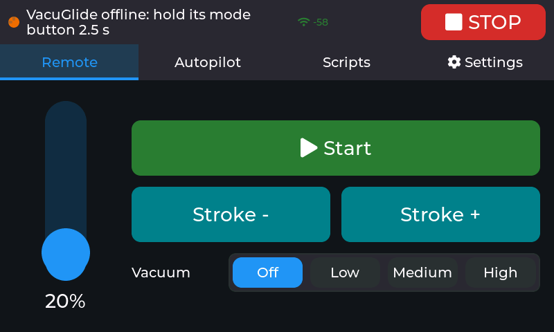
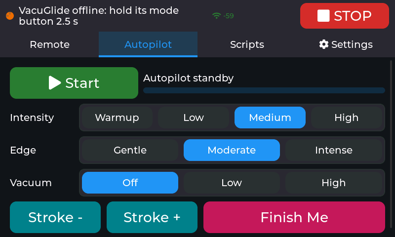
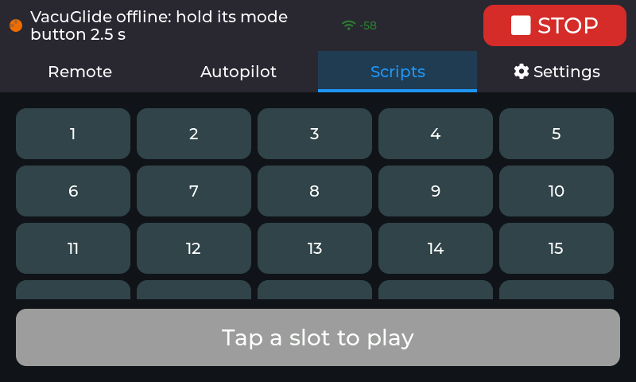

# Twiddle

Twiddle is a standalone touchscreen remote for the **Autoblow VacuGlide**, and since
2.0.0 for other toys too, running on a **Guition JC8048W550** (ESP32-S3, 5"
800x480 touch display). It talks straight to Autoblow's public device API with
your device token, and to Bluetooth toys straight from the panel. No phone, PC
or home-automation hub is needed once it's set up.

Twiddle was called "vacuglide-panel" until 2.0.0-dev.13 (the public GitHub
repository `driftsyncone/vacuglide-panel` is the historical 1.x release and
stays as it is). This folder is the Arduino/ESP32-S3 firmware of the
Twiddle repository. Its ESP32-P4 sibling, for the Guition 7" P4 panel, lives
in **[`../p4`](../p4)**; the cross-hardware feature matrix is kept in
[`../p4/docs/feature-matrix.md`](../p4/docs/feature-matrix.md).

**Renamed in 2.0.0-dev.13:** the panel's network name is now per board:
Guition S3 `twiddle-s3.local` (dev.13 itself used `twiddle`; the P4 sibling uses
`twiddle-p4`), Waveshare `twiddle-ws.local` (was `vgremote`/`vgremote-ws`).
`PANEL_HOSTNAME` in `include/secrets.h` overrides it. The setup Wi-Fi is
`Twiddle-Setup`, and `GET /` starts with `twiddle <version>`. Settings are kept
(the internal NVS namespace keeps its legacy name for settings compatibility).
A board still running the old firmware needs one update: it is reachable under
its old name (`vgremote.local`, Waveshare `vgremote-ws.local`) until then; a
board on dev.13 answers as `twiddle.local`.

> Unofficial community project. Not made, endorsed or supported by Autoblow,
> Lovense or Kiiroo. "Autoblow", "VacuGlide", "VacuPump", "Lovense", "Kiiroo"
> and "Keon" are trademarks of their owners.

| Remote | Autopilot | Scripts |
|---|---|---|
|  |  |  |

Screenshots taken from the panel itself (`GET /screenshot`), with the VacuGlide switched off.

What changed in each version: [CHANGELOG.md](CHANGELOG.md).

## Supported devices

One output (the Remote speed slider or Autopilot) drives every device that
follows it, each at its own scale.

| Device | Connection | What the panel controls | Tested |
|---|---|---|---|
| **Autoblow VacuGlide** | Autoblow cloud (token) | Everything below: speed, Tighter/Looser, vacuum, Autopilot, scripts | yes |
| **Autoblow VacuPump** | Autoblow cloud (token) | Vacuum depth in Manual mode (100 % = 40 kPa) | no |
| **Autoblow Ultra** | Autoblow cloud (token) | Oscillation speed, full stroke | no |
| **Lovense** (the models the Buttplug project knows) | Bluetooth | Vibration 0-20 follows the level; Max: air 0-3 too; rotating models rotate, Solace oscillates | no |
| **Kiiroo Keon** (gen 1), **Keon 2** and **Keon WiFi** | Bluetooth | Continuous full strokes, stroke speed follows the level | no |
| **OSSM** (Research and Desire) | Bluetooth | Speed in Stroke Engine; stroke, depth, sensation and pattern stay as set on the machine, and its knob still caps the speed | no |

<!-- TESTING STATUS: fill in before release -->
At the time of writing, 2.0.0 is compiled and running on both panels; the
Bluetooth toys, the VacuPump and the Ultra haven't been tried on real hardware
yet. Reports welcome.

One Autoblow device per panel (it's one token). The panel works out which
device the token belongs to by itself.

## What it does

- **Remote:** speed slider (5-100 %), Start/Pause, hold-to-open Looser /
  Tighter suction valves, vacuum maintenance Off/Low/Medium/High (short Tighter
  pulses). The VacuGlide-only
  controls grey out when no VacuGlide follows.
- **Autopilot (edging):** an on-device generator. A session is 8 waves: each
  climbs to a peak, holds it, then drops to a rest. The tab shows the planned
  session as a graph (played part grey, playhead, "peak in" and time left; tap
  the graph to jump), with **Back off** (drop to rest now, or rest longer) and
  **More** (to the peak now, or hold it longer and a bit higher) to steer it
  live, and Finish Me. When a session ends, a new one starts.
- **Session:** what Autopilot plays. Intensity, Edge (how long peaks and rests
  last), Vacuum, **Length** (auto or 5/10/20/30 min), **Peaks** (rising,
  shuffled, or wild), three **favourites** (tap loads, hold saves the current
  peaks), **Draw** (drag on the Autopilot graph to set each wave's peak) and
  Reset. Changing a setting mid-session blends in: the waves are re-planned,
  the place in the session is kept.
- **Scripts:** play any of the device's 30 local-script slots, pause/resume.
  Long-press a slot to give it a name (stored on the panel, since the API only
  knows slot numbers). VacuGlide only.
- **Devices:** which devices follow the output and how strongly (see
  [Devices tab](#devices-tab)).
- **Settings:** Wi-Fi (with a network scan), password, device token (only its
  last 3 characters show), screen timeout, **Flip screen** for mounting the
  panel the other way round (touch follows), and a brightness slider (Guition;
  the panel also dims to a quarter after a minute without a touch). Wi-Fi and token apply after
  "Save & restart" (the same button reads "Restart" when nothing changed).
  **Power off** explains the battery button (hold it 2 s; software can't cut
  the power on this board) and offers Screen off. The firmware version is
  shown at the bottom.
- **Screen sleep:** backlight off after 1/5/15 idle minutes (default 5), only
  while nothing is running. The touch that wakes it does nothing else.
- **STOP** on every screen.
- **Connection problems, explained:** the top bar shows Wi-Fi signal strength
  and, when Wi-Fi is down, why (wrong password, network not found, signal lost).
  Short drops are ridden out: the device keeps its last speed and only counts
  as lost after **Wi-Fi gaps** (Settings: 10, 20 or 30 s, default 20 s)
  without an answer ("Wi-Fi dropped / No answer, reconnecting... N s"
  meanwhile). Then the panel stops the session and sends STOP as soon as the
  link is back. The panel restarts a stuck reconnect every 10 s.
- **Bluetooth on/off** (Settings): Bluetooth shares the radio with Wi-Fi and
  forces Wi-Fi into modem sleep, which answers slower and drops sooner on a
  weak signal. It runs only when switched on, or (default) when a toy is
  remembered. Changing it restarts the panel; Scan on the Devices tab turns it
  on. If you only use the VacuGlide, switch it off.

### Themes

Settings tab, **Theme** row: Midnight (dark, the default), Daylight (light), Ocean, Forest,
Ember, Blush. Applies live and is stored in the panel (`theme`). A panel with nothing saved starts in Midnight; a saved choice is kept. The code names
colour *roles* (`src/theme.h`), never values; to add a theme, append one row to
the palette table in `src/theme.cpp` (the row order is the saved index). The
palettes are identical to the ESP32-P4 firmware's; the cross-hardware rule and
feature matrix are in
[`../p4/docs/feature-matrix.md`](../p4/docs/feature-matrix.md). Over the web: `GET /theme`, `/theme?n=N[&save=1]`.

### Devices tab

- **Scan** looks for Bluetooth toys nearby (switch them on first). Each device
  gets a row with its status. With Bluetooth off, the button says **Turn on**
  and restarts the panel with Bluetooth.
- **Connect** a toy to remember it; remembered toys reconnect by themselves
  whenever they're in range. **Forget** disconnects it (stopping it first).
- **Follow** decides whether a device gets the output; the **25 / 50 / 75 /
  100 %** buttons scale what it gets.
- The Autoblow device is always the first row; it comes from the token in
  Settings.

**Bluetooth notes:**

- Up to **3 Bluetooth toys** at once.
- A remembered toy that isn't around is looked for after 15 s, then 30 s,
  60 s and every 2 minutes (each look takes radio time from Wi-Fi). A toy that
  was connected and dropped is retried after 2 s; a Scan that sees it connects
  it right after.
- A toy pairs with one controller at a time: **close the Lovense Remote app**
  (or whatever else last drove the toy) before connecting it to the panel.
  For the OSSM, switch the RADR remote off.
- **OSSM:** home it and leave it in the menu; the panel switches it to Stroke
  Engine. The machine's own speed knob still caps what the panel sends, so
  turn it up. A long press on the machine (its emergency stop) is respected:
  the panel doesn't switch it back.
- A toy that connects (or reconnects) while a session runs stays still until
  you stop and start again.

### Safety notes

- The panel controls Autoblow devices through Autoblow's cloud. **If the panel
  loses its connection, it cannot stop the device.** It shows a red banner
  saying the device may still be running, and sends STOP first as soon as it
  reconnects. Keep the device's own controls within reach.
- If any following device drops out while running (off the cloud, Bluetooth
  link lost), the panel stops everything instead of resuming later.
- **VacuPump:** the pump's own stop keeps the vacuum, so the panel's STOP
  vents it to 0 kPa first, then stops. The pump must be on its **Online**
  screen for the cloud (and so the panel) to reach it.
- Saving settings or installing an update stops every device first.

## Build your own

Everything below is the exact hardware this panel runs on. Prices are what we
paid or saw in 2026 and change often.

### Parts

| # | Part | Where | ~Price | Notes |
|---|---|---|---|---|
| 1 | **Guition JC8048W550C** — ESP32-S3-N16R8, 5" 800×480 IPS, **capacitive** touch | [AliExpress](https://www.aliexpress.us/item/3256807009269027.html), [Surenoo](https://www.surenoo.com/products/23291185) (Guition reseller) | $17–30 | Pick the **capacitive** option (see below) |
| 2 | **1S LiPo, 3.7 V 3000 mAh, size 103665** (≈10 × 36 × 65 mm) with a **JST 1.25 mm** 2-pin plug | [Amazon B0CG1TCXVZ](https://www.amazon.com/dp/B0CG1TCXVZ) (sold as a Miyoo Mini battery) | ~$10–15 | Plugs straight into the board's BAT socket |
| 3 | **Case**: xTouch Pro enclosure for the Guition 5" | [USB-C variant](https://makerworld.com/en/models/1127192-xtouch-pro-usb-hole-variant) (recommended) or [official base with pogo-pin charging](https://makerworld.com/en/models/1016156-xtouch-pro-official-base-for-guition-5inch-lcd) | print it | See "Case" below |
| 4 | USB-C cable + a **2 A or better** USB charger | anywhere | — | The board charges and runs at the same time |

> **Battery not available?** Look for a **Miyoo Mini compatible** replacement
> battery: they're the same size and plug. Still check that the red wire lands on
> **BAT+** before plugging in, since sellers don't always wire them the same way.

Optional, for a battery % on screen (see [Battery level](#battery-level-optional)):

| # | Part | Where | ~Price |
|---|---|---|---|
| 5 | Adafruit **MAX17048** fuel gauge, STEMMA QT | [Adafruit #5580](https://www.adafruit.com/product/5580) | $5.95 |
| 6 | STEMMA QT → male header cable (red 3.3 V, black GND, blue SDA, yellow SCL) | [Adafruit #4209](https://www.adafruit.com/product/4209) | $0.95 |
| 7 | 2 × **JST 1.25 mm ↔ JST-PH 2.0 mm** 2-pin adapters (the gauge has PH 2.0 ports; battery and board are 1.25 mm), or splice the wires | electronics/hobby shops | ~$5 |
| — | The **JST 1.25 mm 4-pin to female jumper ("Dupont") cable** that comes in the box with the board | included | — |

### Getting the right board

Listings often sell all three versions on one page and default to the wrong one.
It's the right board when:

1. It's **Guition JC8048W550** (printed on the back of the board).
2. You picked **capacitive touch** → **JC8048W550C**. Not N (no touch) or R (resistive).
3. **ESP32-S3-N16R8** ("8M PSRAM 16M FLASH"), **800×480**, **ST7262** display driver.
4. The back has a **BAT** socket at the top right, next to the speaker socket.
   Look-alikes such as the Sunton ESP32-8048S050 may not have the battery circuit.

Guition's spec sheet: [JC8048W550 specifications (PDF)](https://www.guition.com/-download).

### What's on the board

- **Power:** an **IP5306** chip charges the battery from USB-C (~2 A), boosts it to
  5 V, runs the panel while charging, and cuts off when the cell is low.
  About 320 mA at 5 V while running.
- **BAT socket (P7):** JST 1.25 mm, **BAT− left, BAT+ right** (looking at the back,
  socket at the top). Check your battery's red wire goes to BAT+ before plugging in;
  a reversed cell can destroy the IP5306.
- **Battery button:** next to the P5 connector. A short press switches the panel on
  when it runs from the battery alone.
- **P4 connector** (from the community pinout; check the silkscreen): GND, 3.3 V,
  GPIO17, GPIO18. The panel uses it for the optional fuel gauge.
- Touch (GT911) is on I2C GPIO19/20; backlight on GPIO2.

### Case

The [xTouch Pro](https://makerworld.com/en/models/1127192-xtouch-pro-usb-hole-variant)
cases were made for this exact board (by the xTouch printer-screen project) and
print on any FDM printer.

- **USB-C variant (recommended):** the USB-C port stays reachable, so you can
  charge and, if ever needed, flash firmware over USB without opening the case.
- **Official base with pogo pins:** charges through magnetic pogo pins on a stand;
  needs the pogo-pin parts listed on its page, and the case has to come apart to
  reach USB.

Check the case's battery space fits your cell (the one above is ≈10 × 36 × 65 mm),
and keep the cell away from the IP5306 and its inductor (top right, near BAT): they
get warm while charging.

### Assembly

1. **Flash first** ([Flash the firmware](#flash-the-firmware) below) while the board is still bare on your desk.
2. Check battery polarity (red → BAT+), then plug the battery into **BAT**.
3. With USB unplugged, **press the battery button** briefly: the panel should start
   on battery. Plug USB-C in: it keeps running and charges. **Hold** the button
   for more than 2 s to cut the power (it stops the panel, not the VacuGlide).
4. Leave it charging for ~10 minutes and feel the battery: warm is fine, **hot means
   unplug** (the charger runs at ~2 A, about 0.7C for a 3000 mAh cell).
5. Fit the board and battery in the case.

### Battery level (optional)

Two ways, the gauge being the better one:

- **Fuel gauge** (below): exact, tracks charging, no soldering.
- **Voltage divider on GPIO17:** two resistors, BAT+ -33 kΩ- IO17 -100 kΩ- GND,
  with IO17 and GND on the P4 header and BAT+ tapped at the battery connector.
  The firmware turns the voltage into a percentage with a LiPo curve: a few
  percent low under load, and it sits at 100 % while charging. `GET /adc` shows
  the raw readings. (The Sunton ESP32-8048S050 has this divider on the board;
  the Guition JC8048W550C doesn't.)

The IP5306 has no data connection, so without extra hardware the panel can't
show the battery level (it runs fine without it). A MAX17048 (or MAX17043)
fuel gauge adds a battery % under the Wi-Fi signal, voltage on the Settings tab,
and a safety stop: **at 5 % or less on battery** the panel stops the VacuGlide
and won't run it until USB is plugged in, so it can't die and leave the device
running.

Wiring with the parts above:

1. Battery → adapter → the gauge's JST-PH port; the gauge's other JST-PH port →
   adapter → board **BAT**. The gauge passes power straight through.
2. Plug the board's included 4-pin cable into **P4**, and push the male pins of
   cable #6 (from the gauge's STEMMA QT port) into its female ends:
   red → 3.3 V, black → GND, blue (SDA) → GPIO17, yellow (SCL) → GPIO18.
   Go by the pin labels printed next to P4 on the board, not by the included
   cable's wire colours, which don't follow a standard.
   The touch bus (SDA GPIO19, SCL GPIO20) works too.

The panel finds the gauge on either bus by itself. On the touch bus it keeps
looking (plug it in whenever); on P4 it only looks at boot, because GPIO17 is
also the battery ADC pin. `GET /i2c` shows what answers (the gauge is at
address 0x36).

> Gauge support is new and not yet tried with a real MAX17048; the display was
> tested with simulated readings. Reports welcome.

### Alternative board: Waveshare ESP32-S3-Touch-LCD-5

If the Guition board isn't available to you, the firmware also builds for the
[Waveshare ESP32-S3-Touch-LCD-5](https://www.waveshare.com/esp32-s3-touch-lcd-5.htm)
([on Amazon](https://www.amazon.com/waveshare-Capacitive-Development-Dual-Core-Resolution/dp/B0DD7N19FT)).
Get the **800×480** touch version, **not** the 1024×600 "5B".

Tested on a real board: picture, touch, Wi-Fi and Wi-Fi updates work. Its
battery side hasn't been tried yet.

How it differs from the Guition build:

- **Build target:** `pio run -e waveshare5 -t upload` (USB) and
  `pio run -e waveshare5-ota -t upload` (Wi-Fi; address from `OTA_HOST_WS` in
  `secrets.h`, default `twiddle-ws.local`). Its network name is
  **`twiddle-ws`**, so it doesn't clash with a Guition panel.
- **Battery:** its own charger (CS8501, about 560 mA, so slower and gentler than
  the Guition's ~2 A) and a battery **ON/OFF switch**. Waveshare: the screen draws
  about 550 mA, so **switch the battery OFF when it's plugged into a computer**
  whose USB port gives less than 500 mA. Waveshare recommends cells up to 2000 mAh
  (at 560 mA a 3000 mAh cell takes about 6 hours to charge). Its docs call the
  socket MX1.25; check your battery's plug and polarity before connecting.
- **No battery %:** there's no battery measurement on the board, and a fuel gauge
  can't be added (its IO-expander chip answers on the gauge's I2C address).
- **Backlight:** on/off only (through the board's CH422G IO expander), so screen
  sleep works but there's no dimming.
- **Case:** a community case, [HexCase](https://makerworld.com/models/3010625), fits
  the touch versions (check it has room for a battery).

### Guition units differ: display pixel clock

If a Guition JC8048W550C shows a colour pattern instead of the UI, its panel needs a different pixel clock than the
default 14 MHz. The firmware is fine (check `GET /screenshot`, which draws the UI). Set the clock over the web and
restart: `curl -u ota:PASSWORD "http://PANEL/pclk?mhz=16"` then `curl -u ota:PASSWORD -X POST http://PANEL/restart`.
Known units differ: one needs 14 MHz, another 16 MHz.

## Flash the firmware

You need [PlatformIO](https://platformio.org/) (CLI or the VS Code extension).

1. `cp include/secrets.example.h include/secrets.h` and fill it in. Wi-Fi and
   token are only defaults; you can also leave them and set them from a phone:
   a panel with no Wi-Fi configured opens its own network **Twiddle-Setup**
   (password `twiddle-setup`); join it and the setup page comes up (or open the
   address the panel shows). On your LAN the same page is `/setup` with the
   OTA login. Or set them on the
   panel's Settings tab later.
2. Plug the panel in by USB (shows up as `/dev/ttyUSB0` on Linux).
3. `pio run -t upload && pio device monitor` (Guition). For the Waveshare board:
   `pio run -e waveshare5 -t upload`.

Back up the stock firmware first if you might want it back:
`esptool --port /dev/ttyUSB0 read-flash 0 0x1000000 stock.bin`

## Updates over Wi-Fi

`pio run -e ota -t upload` builds the firmware and sends it to the panel with
`./ota.sh` (HTTP basic auth: user `ota`, password `OTA_PASSWORD` from
`secrets.h`). The panel stops the VacuGlide, installs, and reboots.

**Safety net:** an update is written to the other firmware slot and only
switched to once it's complete and its checksum verifies, so a cut-off upload
leaves the old firmware running. The new firmware then runs on probation: it
must get onto Wi-Fi and run for 30 s. If it crashes before that, or isn't
confirmed within 3 minutes (frozen, no Wi-Fi), the panel goes back to the
previous firmware by itself. `ota.sh` waits and reports `OK: new firmware
confirmed` or `ROLLED BACK`. `GET /` shows the build time and `firmware:
confirmed/pending`. USB flashing always works as the last resort.

`ota.sh` sends to `OTA_HOST` from `secrets.h` (default `twiddle-s3.local`, the
panel's mDNS name). Override with `PANEL_HOST=<panel IP>` or a second argument.
If the panel sits on an isolated IoT network, allow your computer to reach it
on TCP port 80.

`GET /screenshot?tab=0..5` (same login) returns the screen as a BMP and can
switch tabs first: 0 Remote, 1 Autopilot, 2 Session, 3 Scripts, 4 Devices,
5 Settings (which shows your Wi-Fi name and the token's last 3 characters:
don't publish that one). `GET /i2c` lists the chips
answering on the touch bus and the P4 connector, `GET /adc` the raw battery ADC
readings. `POST /restart` (same login) restarts the panel when the screen is
unusable, e.g. `curl -u ota:PASSWORD -X POST http://twiddle-s3.local/restart`,
and `POST /resync` restarts only the display output. `GET /` shows the version,
build id, board, firmware state and the reason for the last reset.

**Security, plainly:** the Wi-Fi password, device token and OTA password from
`secrets.h` sit unencrypted in the firmware image and in the panel's flash, and
updates travel over plain HTTP on your LAN with Basic auth. Fine for a device on
your own network; don't publish a built `firmware.bin`, and treat the panel's
USB port like the token itself.

## How it's built

| File | What |
|---|---|
| `src/board.cpp` | Per-board pins and timings (Guition / Waveshare), RGB panel, GT911 touch, LVGL glue, backlight |
| `src/autoblow.cpp` | Network task: desired-state sync to the API (VacuGlide, VacuPump, Ultra), keep-alive HTTPS, state polling |
| `src/control.cpp` | Modes: remote, Autopilot generator, vacuum pulses, scripts, STOP |
| `src/devices.cpp` | Fans the one output out to every following device, scaled; loss detection |
| `src/ble.cpp` | Bluetooth task (NimBLE): scan, connect, remembered toys, levels, battery |
| `src/toys/` | Per-brand Bluetooth protocols: Lovense, Kiiroo Keon / Keon 2 |
| `src/ui.cpp` | LVGL screens |
| `src/wlan.cpp` | Wi-Fi connect, retry watchdog, disconnect reasons, signal, mDNS |
| `src/battery.cpp` | Battery level: MAX17048/MAX17043 gauge on either I2C bus, or a voltage divider on the ADC pin |
| `src/settings.cpp` | NVS: Wi-Fi + token (override secrets.h), screen timeout, script names |
| `src/ota.cpp` | Firmware upload (`POST /update`), `/restart`, `/resync`, `/screenshot`, `/i2c`, `/adc`, status (`/`) |
| `src/rollback.cpp` | Update probation: confirm after 30 s healthy on Wi-Fi, else roll back |
| `src/lv_mem_psram.c` | LVGL heap in PSRAM, so widgets don't take internal RAM from TLS |

The UI only sets a *desired* state; a network task on the other core sends
whatever differs, one request at a time, and retries until it lands. STOP
forgets what was sent, so everything is resent. Bluetooth toys work the same
way: the UI sets a level per toy, the Bluetooth task sends what changed.

TLS buffers and the Bluetooth host live in PSRAM, so Bluetooth fits next to
the cloud connection. Wi-Fi modem sleep (minimum) is on only while Bluetooth
runs, which requires it; Bluetooth connects and scans listen a quarter / half
of the time, so Wi-Fi keeps the rest of the radio. `GET /` shows signal,
channel, power save, Wi-Fi drops and cloud losses; `/log` logs each drop with
its reason and how long the link took to come back.

## Credits

The Bluetooth toy protocols come from:

- the [Buttplug project](https://github.com/buttplugio/buttplug) (Lovense and
  Kiiroo device definitions and protocol code), BSD-3-Clause, Copyright (c)
  2016-2026 Nonpolynomial Labs, LLC;
- Kiiroo / FeelRobotics' keon-wifi-sdk (Keon 2 details), MIT, Copyright (c)
  2025 FeelRobotics.

Each driver in `src/toys/` names the files it follows. See
[THIRD_PARTY_NOTICES.md](THIRD_PARTY_NOTICES.md).

## License

[CC BY-NC-SA 4.0](LICENSE): you may use, change and share this project for
**non-commercial** purposes, with credit, and anything you build from it must be
shared under the same license. Third-party components keep their own licenses;
see [THIRD_PARTY_NOTICES.md](THIRD_PARTY_NOTICES.md).
